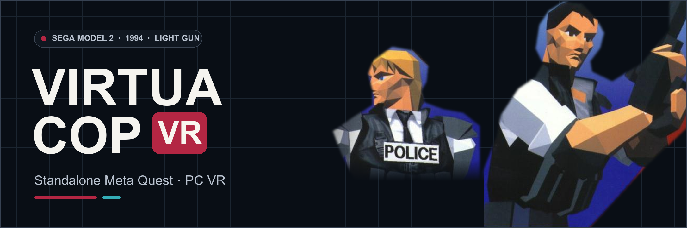

# Virtua Cop VR
### Sega Model 2 Arcade Light-Gun Action · Standalone Meta Quest & PC VR

**[⬇️ Quest APK](https://github.com/vr4all-standalone/vcop-vr/releases/latest/download/vcop-vr-quest.apk)** · **[🖥️ PC VR ZIP](https://github.com/vr4all-standalone/vcop-vr/releases/latest/download/vcop-vr-pcvr.zip)** · **[🎮 Controls](#controls)**

[Checksums](https://github.com/vr4all-standalone/vcop-vr/releases/latest/download/SHA256SUMS.txt) · [Complete source](https://github.com/vr4all-standalone/vcop-vr/releases/latest/download/vcop-vr-source.zip) · [All releases](https://github.com/vr4all-standalone/vcop-vr/releases)

**[🌐 VR4ALL — Standalone VR Mod Installer](https://github.com/vr4all-standalone/vr4all-standalone)**  
**[☕ Donate to VR4ALL](https://ko-fi.com/vr4all)**

---

## Update v0.1.9

- Defaults and Reset now match the captured Quest profile: Arcade, Laser On, Shoot off-screen reload, and Custom reticle 20% minimum / 35% maximum / 7.0 m shrink. Existing valid preferences are preserved.

- Shared wide VR4ALL setup panel, with validated automatic entry and manual Play.
- Full player-colored Arcade body and grip, with original grey screws and lens details. P1 red / P2 blue follow player identity across hand swaps.
- New gun angle 0 matches the old -10-degree pose. Legacy angles reset once; later choices and other settings persist.

## Overview

Experimental port of original arcade Virtua Cop Revision B for Quest 3/3S and Windows OpenXR. Version 0.1.9, Android code 10/package `com.vrlightgunhub.vcop`. This experimental VR port is available as Quest, PCVR and complete-source downloads.

This uses native Model 2 geometry, materials, HUD, sound, game logic and pacing. Each eye renders signed camera-space geometry with head rotation and lean. VC1's native cloud polygons render infinitely far away with their own transparency; original hearts, ammo cylinders and score graphics remain native HUD elements. In-game gun follows each player's native equipment. Its standard model is the original scene pistol and hand used cosmetically; Arcade and Zapper are the other two choices.

Quest setup requires your owned **Revision B** media under `Download/vcop-vr/`. Supply `vcop.zip` and `model1io2.zip`, or one complete `vcop.zip` with all 28 verified ROM payloads. An optional `hd44780.zip` may supply the LCD font if absent from the I/O archive. The LCD font has MAME's known BAD_DUMP status. Existing top-level Virtua Cop archives belong to other apps and are preserved. The app verifies actual size, CRC32 and SHA1 before launch. No game data is distributed.

For PCVR, enable the headset's OpenXR runtime, place the owned archives under the portable folder's `roms/`, and run `run-pcvr.cmd`. Settings and native NVRAM use its independent `userdata/` folder. `launch-pcvr.ps1 -RomDirectory D:/MyRoms` selects another media folder.

## Controls

The purple menu includes Resume, Recenter, Gun, Gun angle, Reload, Two players, Laser, Haptics, World size, Panel distance, Gun size, Wider view, View width, Game zoom, How to play, Open Service Menu and Quit. Tap/release either grip to toggle native zoom, with a brief purple status message; it starts Off each launch. The grip help leader targets the squeeze button. Native shooting/reload white strobes are hidden during VR rendering while native gun reads remain intact. In-game gun follows Rifle, Automatic, Machine Gun, Shot Gun and Magnum pickups independently for each player. Common settings follow the overseer contract. Native Gun Setting calibration remains available through the service menu. Held controls are released across focus, menu and ownership changes.

Build the host with CMake/Ninja and the engine with `tools/build-engine.ps1`, supplying a dedicated source/build path without spaces. Both targets use pinned MAME 0.289 commit `f34f02505e32c1993c6a782b6814232cbfc74e36`; `tools/sync_engine_patches.py` verifies the complete cumulative patch state. `tools/build-quest.ps1` uses a separate signing key and builds the ARM64 host, engine and APK. Run `python -B -m unittest discover -s tests -v` and CTest after configuring the host. Private ROM, native-asset and capture tests run only when their own research fixtures exist.

See [validation](docs/validation.md), [design](docs/design.md), [credits](CREDITS.md) and `licenses/` for evidence, limitations and attribution.

## Your game files

Supply your owned vcop.zip and, unless combined in that ZIP, model1io2.zip with the I/O/LCD firmware in `Download/vcop-vr/`. Setup verifies the actual ROM lengths, CRC32 and SHA1; no game data is supplied.

## Installation (Meta Quest)

Install the Quest APK, open Virtua Cop VR under Unknown Sources, and allow game-file access. The app checks the files and enters VR automatically when ready.

## Installation (PC VR)

Extract the PCVR ZIP, enable your headset’s OpenXR runtime, place the owned archives in the portable `roms/` folder, and run the supplied PCVR launcher.

## Banner artwork

[Original Sega flyer artwork and banner attribution](docs/github/ARTWORK.md).
